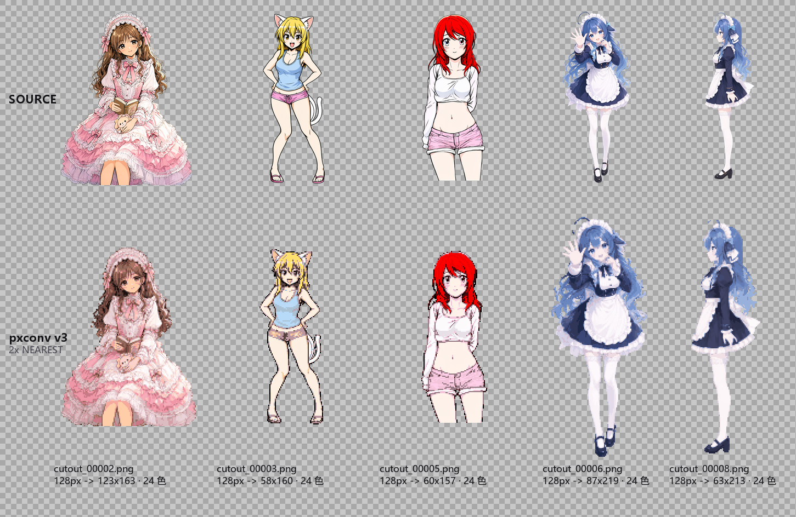
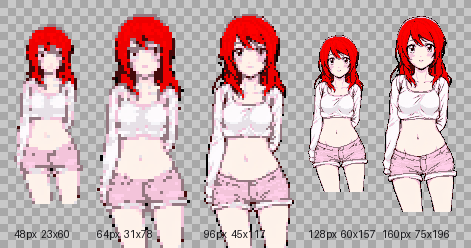

# pxconv

> **Alpha-aware pixel-art downscaler: turn a transparent PNG (cut-out / AI render) into a game-ready sprite.**
> A plain resize leaves a semi-transparent dirty fringe, eats 1-pixel fingers and hair strands, and blows the
> colour count up into the thousands. pxconv fixes all three with **exact area coverage + core-pixel colour
> sampling + thin-structure rescue** — and parameter tweaks take milliseconds.

English ｜ **中文** → [README.md](README.md)


*The repo ships 5 real test images (`assets/testset/`: cut-out AI character renders, mixed 896×1152 and 768×1344, all with an `alpha = 1/255` "fake transparency" background). Every number below comes from these 5 files.*

---

## 1. Results (5 real images, reproducible)

Fixed setting: **output width 128 px / 24 colours**, CPU only.

| Metric | Plain NEAREST / LANCZOS resize | **pxconv v3** | Verdict |
|---|---|---|---|
| Semi-transparent pixels (dirty fringe) | **55,697 / 66,324** (sum over 5 images) | **0** | wiped out in 5/5 images |
| Distinct alpha levels (mean) | 181 / 247 | **2** (only 0 and 255) | per-pixel editable, palette-swappable |
| Visible colours (mean) | 5,559 / 6,055 | **24.0** | `--colors 24` is a hard cap; exactly 24 on all 5 |
| Thin-structure recall (fingers, strands, thin belt details) | v2 family **12.2%** | **43.7%** | **3.6×** (12.9% with rescue off) |
| Fragmentation (4-connected components, mean) | 7.2 | **2.6** | broken limbs merge back from ~7 pieces to ≤3 |
| Param-change time (preprocessed cache hot, mean) | v2 majority **622 ms**<br>v2 area-mean 49.5 ms | **22.0 ms** | **28×** vs majority (23.9–34.9× per image) |
| Content near the bottom of the image | 896×1152→128 px **drops 162 rows (14.06%)** | full coverage, 0 rows lost | see "Measurement caliber" and algorithm #1 |

**Per-image detail** (the recall column is normalised over the region *each algorithm actually renders* — see "caliber"):

| Test image | Source | Semi-transparent px in source | NEAREST semi px / colours | **pxconv semi px / colours** | Recall v2 → v3 | Cached time v2 majority → v3 |
|---|---|---|---|---|---|---|
| cutout_00002 | 896×1152 | 376,295 (36.5%) | 7,713 / 10,538 | **0 / 24** | 11.2% → **53.9%** | 626 → **21 ms** |
| cutout_00003 | 896×1152 | 475,269 (46.0%) | 9,840 / 2,541 | **0 / 24** | 17.0% → **22.3%** | 610 → **20 ms** |
| cutout_00005 | 896×1152 | 456,376 (44.2%) | 9,391 / 3,008 | **0 / 24** | 15.1% → **77.5%** | 600 → **17 ms** |
| cutout_00006 | 768×1344 | 496,509 (48.1%) | 13,947 / 7,301 | **0 / 24** | 8.2% → **31.3%** | 639 → **27 ms** |
| cutout_00008 | 768×1344 | 530,984 (51.4%) | 14,806 / 4,407 | **0 / 24** | 9.4% → **33.7%** | 636 → **25 ms** |



*Gallery: top row = source, bottom row = pxconv v3 output (target width 128 px / 24 colours, uniformly upscaled 2× with NEAREST so the pixel grid is visible). All five outputs land at 0 semi-transparent pixels, 2 alpha levels and 24 colours.*



*One character (cutout_00005) at 48 / 64 / 96 / 128 / 160 px. Displayed with integer NEAREST upscaling, hence the slightly uneven heights; below 96 px fingers and facial features start to smear, 128 px is the balance point, 160 px if you want detail.*


*cutout_00005 (the image with the largest v3 gain), five panels: v2 area mean | v2 majority | **v3 core, the default** | v3 core + edge-colour stretch | v3 with rescue off. Checkerboard = transparency.*


*The densest difference region at 10× (NEAREST): rescue on (left) vs off (right). Look at where the thin diagonal strand meets the body and at the thin strip hanging from the top — the right side breaks, the left side stays connected.*

**Reproduce it** (works from a fresh clone, no private assets needed):

```bash
python tools/benchmark.py assets/testset/cutout_00005.png --size 128 --colors 24 --crop-control
python tools/edge_bench.py assets/testset/cutout_00005.png --sizes 64,128 --colors 16
pytest -q tests/                                     # 11 invariant tests
```

**Environment**: Windows 10 · Python 3.14.7 (code targets ≥3.10) · numpy 2.5.3 · Pillow 12.3.0 · Ryzen 5700X3D / 16 GB,
**pure CPU** (no GPU, no torch). CI on Linux (GitHub Actions, Python 3.10 / 3.12 / 3.13) is green as well.

### Measurement caliber: why v2's recall is normalised over *its own* region

v2's integer blocking crops the bottom of the image (see algorithm #1), so the region it actually renders is smaller
than v3's. Measuring v2 against the v3 grid misaligns the content and **inflates** the score: on this corpus v2 gets
**21.3%** under the v3 grid, but only **12.2%** over the region it really renders. The table above uses the latter
(fair caliber: of the part that was rendered, how much thin structure survived); the dropped rows are reported separately.

---

## 2. Why the algorithm is better

### 1. Exact area coverage on a fractional grid (integral image), not integer blocking

The usual shortcut is `arr[:bh*rows].reshape(rows, bh, ...)` — and **`bh = h // rows` silently truncates the bottom
of the image**. For 896×1152 → 128 px width: `rows = 165, bh = 6`, covering only **990 rows = 14.06% of the height
discarded**; anything hugging the bottom vanishes. Yet 768×1344 → 128 px gives `1344/224 = 6` exactly, so **not a
single row is lost** — that is what makes this bug so nasty: **it only fires at certain aspect ratios, while the output
size looks perfectly normal.**

pxconv treats every output cell as a rectangle with float boundaries and sums a 5-channel **summed-area table**
(alpha sum, core-pixel count, core RGB sum) with **bilinear boundary sampling**: O(1) per cell, and the cells always
tile the whole image. `tests/test_pxconv.py::test_fractional_grid_covers_whole_image` asserts the reconstructed alpha
mass matches the source within 0.1%; `::test_v3_keeps_bottom_content_that_v2_crops` is the negative control for the bug
(v2 keeps 0 cells, v3 keeps ≥20).

### 2. Sample colours only from *opaque core* pixels — no darkened fringe

Alpha-weighted averaging folds semi-transparent edge pixels into the colour, and after background removal those pixels
carry the **hidden RGB of the background** (usually black), so the average comes out dark. pxconv only counts pixels
with `alpha >= --core-thr` (default 0.7) for colour, and fits the palette on those same core pixels, so fringe colours
can never pollute it.

These 5 sources each carry **376,295–530,984 semi-transparent pixels (36%–51% of the canvas)**; averaging them in would
be a disaster. `--alpha-thr 0.5` declares them "not present" and colour comes only from core pixels.

### 3. Thin-structure rescue (hysteresis) — 1-px fingers, strands and belt details survive

A pure threshold ("cell exists iff coverage ≥ 0.5") is guaranteed to cut thin lines at small output sizes. pxconv keeps
a *weak* cell when **coverage ≥ 0.4 × threshold AND at least 2 of its 8 neighbours are solid** — thin lines attached to
the body survive, isolated noise does not. Cells without any core pixel are filled with the **nearest core colour**
(iterative diffusion) so thin lines don't become black holes.

Measured (mean over 5 images): **12.2% → 43.7% (3.6×)**, with cutout_00005 going 15.1% → **77.5%**; connected
components 7.2 → 2.6. Turning rescue off immediately falls back to 12.9% — **the gain really comes from this step,
not from some lucky re-tuning elsewhere.**

### 4. Palette "closure" — `--colors` is a hard ceiling

Naive edge re-colouring writes a *mean of neighbours*, which is not in the palette, so a 24-colour request quietly
becomes hundreds (the naive baselines land at 2,541–10,538 colours on this corpus). pxconv performs edge re-colouring
as **palette-index operations** (interior mode / interior original colour pushed outward) and finishes with
`snap_to_palette()`, so the visible colour count can never exceed `--colors`: **exactly 24 on all 5 images**, and
`test_palette_cap_is_enforced` checks 8/16/24.

### 5. Binarised alpha + hard silhouette = an actual pixel-art asset

Output alpha is 0/255 only (**alpha levels = 2, semi-transparent pixels = 0** on all 5). If you want soft edges
(glowing art, UI) use `--alpha-mode keep`, which keeps the coverage gradient — at that point it is no longer pixel art,
and that trade-off is explicit rather than accidental.

### 6. Preprocess once, cache per image → parameters are interactive

`prepare()` builds the integral image once per image (~100 ms including decode for 896×1152); palettes are cached by
`(colors, core_thr, method)`; per-cell queries are O(1). Parameter tweaks drop from **622 ms** (v2 majority) to
**22 ms** — 28× (23.9–34.9× per image), and 2.3× faster than v2 area-mean too. The palette uses PIL's median cut
(C implementation) instead of a hand-written k-means (1.5 s → 20 ms).

---

## 3. Quick start

```bash
git clone https://github.com/Satyr-Astry/pxconv.git
cd pxconv
python -m venv .venv && . .venv/bin/activate     # Windows: .venv\Scripts\activate
pip install -r requirements.txt                  # numpy + pillow, that's all
```

**One image (recommended defaults)**

```bash
python pxconv.py assets/testset/cutout_00005.png -o out.png --size 128 --colors 24
```

**Batch a folder**

```bash
python pxconv.py assets/testset/ -o out/ --size 96 --colors 16
```

Two files are produced: `out.png` (native-size, true pixel sprite) and `out_preview.png` (NEAREST upscale on a
checkerboard, grid lines only at ≥8×). `--size` is the target width **before** transparent-border trimming, so the
final size is smaller (e.g. 128 → 64×160). That is expected, not a bug.

**As a library**

```python
import argparse, pxconv as P

src = P.load_rgba("assets/testset/cutout_00005.png")   # HxWx4 float32 in 0..1
cols, rows = P.target_grid(src.shape[0], src.shape[1], 128, None)
o = argparse.Namespace(size=128, pixel_size=None, colors=24, alpha_thr=0.5,
                       cov_thr=0.5, core_thr=0.7, rescue="on", palette_method="median",
                       alpha_mode="hard", edge="none", edge_color="keep",
                       sample="core", despike=1, pad=0, no_trim=False,
                       preview_scale=4, no_preview=True)
sprite = P.convert(src, cols, rows, o, prep=P.prepare(src, 0.7))   # reuse/cache `prep`
P.save_rgba(sprite, "sprite.png")
```

`pip install .` also gives you a `pxconv` console entry point.

---

## 4. Parameters

| Flag | Values | Default | Meaning |
|---|---|---|---|
| `input` / `-o` | path | — | input file or folder / output |
| `--size` | int | — | target output **width** (before trimming) |
| `--pixel-size` | int | — | alternative: merge every N source pixels into one |
| `--colors` | int | `16` | palette ceiling (`0` = unlimited) |
| `--sample` | `core` / `mean` / `majority` / `center` | `core` | `core` = v3 (recommended); the rest are the legacy v2 modes, kept for comparison |
| `--core-thr` | 0..1 | `0.7` | how opaque a pixel must be to count as a colour sample |
| `--alpha-thr` / `--cov-thr` | 0..1 | `0.5` | coverage threshold; raise it to slim the silhouette |
| `--alpha-mode` | `hard` / `keep` | `hard` | `hard` = alpha 0/255 (pixel art); `keep` = keep soft edges |
| `--rescue` | `on` / `off` | `on` | thin-structure rescue |
| `--edge` | `none` / `shrink` / `grow` | `none` | erode / dilate the silhouette by 1 px (kills cut-out halo) |
| `--edge-color` | `keep` / `avg` / `stretch` | `keep` | edge colour repair (`stretch` removes dark rims best, slightly recolours the outline) |
| `--palette-method` | `median` / `kmeans` | `median` | palette fitting (`kmeans` is more even but slow) |
| `--despike` | int | `1` | remove isolated pixels with ≤1 visible neighbour (0 = off) |
| `--no-trim` / `--pad N` | flag / int | trim on / `0` | keep transparent border / pad N px after trimming |
| `--preview-scale` / `--no-preview` | int / flag | `6` / off | preview zoom / skip preview |

**Size guidance (from this 896×1152 / 768×1344 corpus)**: **start at 128 px (balanced), 160 px for detail**; below
96 px you clearly lose hands and feet. Flat anime shading is fine at 16–24 colours; photo-like art looks muddy at 24,
use 48+.

---

## 5. Local web UI (tweak parameters, see it instantly)

```bash
python ui/server.py 8765        # then open http://127.0.0.1:8765
```

On Windows just double-click `scripts/start-ui.bat`. Stdlib only (`http.server`) — **no Flask, no extra deps**.
Three columns: original (checkerboard) | result + 8 live metrics | parameters + batch panel.
Ships with 7 presets, debounced auto-recompute, zoom preview, `Download PNG` / `Save to path`, and folder batch mode
that also zips the results.


*Any parameter change re-runs the whole image: the 34×72 sprite above takes ~12 ms, repeatedly, on the same input.*

HTTP API: `POST /api/convert`, `POST /api/save`, `POST /api/batch`, `GET /api/presets`.

---

## 6. Layout

```
pxconv.py              core algorithm + CLI (single file, numpy/Pillow only)
ui/server.py           local web UI backend (http.server, zero framework)
ui/index.html          UI front-end (three panes / presets / live metrics / batch)
tools/benchmark.py     speed · thin-structure recall · bottom-crop control (reproducible experiments)
tools/edge_bench.py    edge parameter matrix (metric table + preview per config)
tools/contact_sheet.py multi-size contact sheet (pick 48/64/96/128/160)
tools/compare_sheet.py side-by-side algorithm comparison image
tools/make_sample.py   generate the synthetic soft-alpha test image
tests/test_pxconv.py   11 invariant tests (pytest, or plain `python`)
assets/testset/        5 real test images (cut-out AI character renders, RGBA)
assets/                comparison sheets, zoom detail, UI screenshot, synthetic sample
docs/ALGORITHM.md      algorithm derivation, pipeline order, metrics, parameter sensitivity (Chinese)
scripts/start-ui.bat   one-click UI launcher on Windows (CRLF, ASCII-only)
```

---

## 7. Limits and negative results (honest list)

- **The gain depends on thin structures actually being there**: on this corpus cutout_00003 only moves 17.0% → **22.3%** (chunky subject, few thin lines) while cutout_00005 reaches **77.5%**. Rescue is not a magic filter.
- **v3 with rescue off ≈ v2 in quality** (12.9% vs 12.2%): v3's silhouette advantage comes from the rescue mechanism itself, not from some other threshold magic. This has to be said out loud.
- **"Edge colour delta" is a false signal on line-art.** It treats the character's own black linework as an unclean edge, so an algorithm that smears the linework away scores better. Use **thin-structure recall + component count + your eyes**. The metric was removed from the UI and only survives in `tools/edge_bench.py`.
- **Don't use `--edge shrink` at very small output sizes** — it severs 1-px structures and the edge-delta number jumps to 50+ (not bleed; the reference measurement breaks once the thin structure is gone).
- **`--alpha-mode keep` does not produce pixel art** — it keeps hundreds of alpha levels (1,359 semi-transparent pixels at 64 px on the synthetic sample). Soft-edged art only.
- **No upscaling.** This is a downscaler; the preview upscale is NEAREST and invents nothing.
- **No light-outline enhancement** (the PixelOE-style look). An outline pass was implemented and intentionally disabled — the code stays in the "archive" block at the bottom of `pxconv.py`.
- **No shared palette across animation frames** — pin the palette yourself or colours will flicker during playback.
- **Integral-image memory is O(5·W·H·4B)**: ~21 MB for 896×1152, hundreds of MB at 4K. Tile very large inputs.
- **`--palette-method kmeans` is slow** at megapixel scale; `median` (PIL median cut) is the real-time path.
- **Genuinely soft content** (translucent shadows, smoke, glows) always loses detail under hard alpha — the method being the wrong tool, not a bug.

---

## 8. License

MIT — see [LICENSE](LICENSE). Third-party reference notes live in [NOTICE.md](NOTICE.md); no third-party code is
included in this repository. The 5 character renders in `assets/testset/` are the author's own AI-generated images
(background removed) and are shipped purely as test fixtures.
