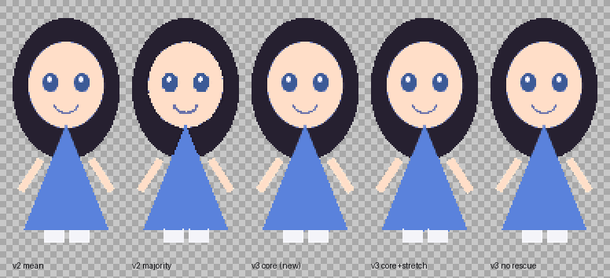

# pxconv

> **透明通道图片 → 像素素材（游戏 sprite）的「边缘优先」像素化工具。**
> 常规缩放会把抠图毛边糊成一圈半透明脏边、把 1px 的手指细腿吃掉、把颜色数炸到三千；
> pxconv 用**精确面积覆盖率 + 核心像素取色 + 细结构救援**解决这三件事，并且改参数是毫秒级。

**English** → [README.en.md](README.en.md) ｜ 中文



*上图为同一张图的五组算法并排（左→右：v2 面积平均 / v2 多数投票 / **v3 core（默认）** / v3 core+去暗边 / v3 关掉细结构救援），棋盘格代表透明区。*

---

## 一、主要成果（本机实测，可复现）

测试图：**896×1152 RGBA 抠图立绘**，其中 **456,376 个半透明像素**、背景是 `alpha=1/255` 的「假透明」、透明区还带非零 RGB（典型的 rembg / 魔棒抠图产物）。
目标：**输出宽度 128px、调色板 24 色**。

| 指标 | 普通做法 | **pxconv v3** | 说明 |
|---|---|---|---|
| 半透明像素（像素画里是脏边） | 9,391（NEAREST）<br>11,400（LANCZOS） | **0** | alpha 只有 0 / 255 两种取值 |
| alpha 取值级数 | 126 / 234 | **2** | 可被逐像素编辑、可 palette swap |
| 输出可见色数 | 3,008 / 3,914 | **24** | `--colors 24` 真的生效（边缘配色不会把色数炸掉） |
| 细结构保留率（手指/发丝/尾巴尖） | 28.6% | **77.5%** | 关掉救援是 18.2%，救援带来 ≈4.3× |
| 细结构碎片化（4-连通块数） | 4 | **1** | 7 → 1：救援后不再断成一堆碎片 |
| 改参数耗时（积分图已缓存） | 607 ms | **18 ms** | ≈ **34×** 提速，UI 里拖滑块才可能实时 |
| 主体在图片底部时是否丢内容 | **整块丢失**（0 格） | **768 格** | 整数分块只覆盖 990/1152 行，见下文「底部裁剪」 |
| 边缘色差（边缘色 vs 内圈色，0~441） | 2.2 | **1.5** | 越小越好；对线稿图此指标不可用（见局限） |

同一套代码跑自带的 256×320 合成示例图（`assets/sample_raw.png`，3547 个半透明像素）：

| 输出 | 半透明像素 | alpha 级 | 色数 | 细结构保留率 |
|---|---|---|---|---|
| 普通 NEAREST → 64px | 262 | 59 | 206 | — |
| 普通 LANCZOS → 64px | 762 | 170 | 548 | — |
| **pxconv → 64px / 16 色** | **0** | **2** | **15** | **94.7%**（关救援 67.1%） |

复现命令（克隆后直接跑，不需要我的任何素材）：

```bash
python tools/benchmark.py --size 64 --colors 16 --crop-control    # 速度/细结构/底部裁剪
python tools/edge_bench.py --sizes 64,128 --colors 16             # 边缘参数矩阵
pytest -q tests/                                                  # 11 条不变量测试
```

**环境**：Windows 10 · Python 3.14.7（代码兼容 ≥3.10） · numpy 2.5.3 · Pillow 12.3.0 · AMD 5700X3D / 16GB，纯 CPU 实现（无 GPU、无 torch）。

---

## 二、算法优点

### 1. 精确面积覆盖率（分数边界 + 积分图），不是整数分块

大多数实现的做法是 `arr[:bh*rows].reshape(rows, bh, ...)` —— **`bh = h // rows` 的整数除法会静默裁掉图片底部**。
实测 896×1152 → 128 宽时 `rows=165, bh=6`，只覆盖 **990 行 = 丢掉 14% 的高度**，主体一靠下就整块消失。

pxconv 把每个输出格当成**浮点边界**的矩形，用一张 5 通道积分图（Summed-Area Table：alpha 和、核心像素计数、核心 RGB 和）做**双线性边界求和**，
每格代价 O(1)，且格子一定铺满整张图（`tests/test_pxconv.py::test_fractional_grid_covers_whole_image` 断言覆盖率总量与源图误差 < 0.1%）。

> 底部内容对照（896×1152 合成图，主体只在底部 5%，输出 128px）：
> v2 面积平均 / 多数投票 = **0 个底部像素**；v3 = **768 格**。

好处：任意缩放比例（含非整数倍）都成立；不存在「图被裁掉一半还看不出来」的静默 bug。

### 2. 只用「不透明核心像素」取色 —— 边缘不会发暗

面积平均（alpha 加权）会把半透明边缘像素算进去，而抠图后的半透明像素**带着背景的隐藏 RGB（常见是黑）**，
平均一下边缘就发暗发灰。pxconv 的取色只统计 `alpha >= --core-thr`（默认 0.7）的**核心像素**，
半透明 / 透明像素对颜色**零贡献**；调色板拟合也只用核心像素，避免毛边色污染调色板。

好处：去黑边不需要额外滤镜，源头就不脏；`--edge-color stretch` 只是锦上添花（把 1px 边缘换成内圈原色）。

### 3. 细结构救援（hysteresis）—— 1px 手指、发丝、尾巴尖不会消失

纯阈值法把「覆盖率 ≥ 0.5」作为像素是否存在，细线在小输出尺寸下覆盖率天然低于阈值 → 断手断腿。
pxconv 保留两类「弱格」：**覆盖率 ≥ 0.4×阈值** 且 **8 邻域里至少 2 个实心格** —— 符合的细线会活下来，孤立噪点不会。
另外，没有核心像素的格子用**最近核心色逐层扩散填充**，避免细线变成黑色空洞。

实测（真实立绘 128px）：细结构保留率 18.2% → **77.5%**；连通块数 7 → **1**（不再碎片化）。

### 4. 调色板「收口」—— `--colors` 是硬上限

边缘修色如果直接写「邻居平均色」，平均色不在调色板里 → 色数从 24 爆到 197，`--colors` 形同虚设。
pxconv 的边缘配色改为**调色板索引操作**（取内圈众数色 / 内圈原色外推），最后统一 `snap_to_palette()` 收口，
所以可见像素永远 ≤ `--colors`（`test_palette_cap_is_enforced` 在 8/16/24 三档都断言）。

### 5. alpha 二值化 + 硬边轮廓，得到的是「真像素画」

输出 alpha 只有 0 / 255，不存在「半透明毛边」；可选形态学 `shrink/grow` 修 1px 光晕。
需要柔边（发光立绘、UI 图）时用 `--alpha-mode keep` 保留覆盖率渐变 —— 那时它就不是像素画了，这是明确的取舍。

### 6. 一次预处理 + 按图缓存 → 参数可以随便拖

`prepare()` 每张图只建一次积分图（896×1152 约 108 ms），调色板按 `(colors, core_thr, method)` 缓存，
SUR 查询每格 O(1)。所以「改参数」这一动作从 607 ms 降到 **18 ms**；调色板用 PIL 中位切分（C 实现）而不是自写 k-means（1.5 s → 20 ms）。

---

## 三、快速开始

```bash
git clone https://github.com/Satyr-Astry/pxconv.git
cd pxconv
python -m venv .venv && . .venv/bin/activate     # Windows: .venv\Scripts\activate
pip install -r requirements.txt                  # numpy + pillow，仅此两个
```

**单张转换（推荐默认参数）**

```bash
python pxconv.py 立绘.png -o out.png --size 128 --colors 24
```

**批量**

```bash
python pxconv.py 素材目录/ -o 输出目录/ --size 96 --colors 16
```

输出两张：`out.png`（原生尺寸真像素 sprite）与 `out_preview.png`（NEAREST 放大 + 棋盘格；≥8× 时叠网格线）。
`--size` 是**裁边前**的目标宽度，最终尺寸会更小（例如 128 → 68×143），这是正常行为。

**当作库调用**

```python
import argparse, pxconv as P

src = P.load_rgba("立绘.png")                  # HxWx4 float32, 0~1
cols, rows = P.target_grid(src.shape[0], src.shape[1], 128, None)
o = argparse.Namespace(size=128, pixel_size=None, colors=24, alpha_thr=0.5,
                       cov_thr=0.5, core_thr=0.7, rescue="on", palette_method="median",
                       alpha_mode="hard", edge="none", edge_color="keep",
                       sample="core", despike=1, pad=0, no_trim=False,
                       preview_scale=4, no_preview=True)
sprite = P.convert(src, cols, rows, o, prep=P.prepare(src, 0.7))   # prep 可复用/缓存
P.save_rgba(sprite, "sprite.png")
```

或者 `pip install .` 后用命令行入口 `pxconv`。

---

## 四、参数

| 参数 | 取值 | 默认 | 作用 |
|---|---|---|---|
| `input` / `-o` | 路径 | — | 输入（文件或目录）/ 输出 |
| `--size` | 整数 | — | 目标输出**宽度**（裁边前） |
| `--pixel-size` | 整数 | — | 换一种说法：每 N 个源像素并 1 像素 |
| `--colors` | 整数 | `16` | 调色板上限（`0` = 不限） |
| `--sample` | `core` / `mean` / `majority` / `center` | `core` | `core` = v3（推荐）；其余是 v2 老算法，留作对比 |
| `--core-thr` | 0~1 | `0.7` | 多大 alpha 才算「核心像素」（参与取色） |
| `--alpha-thr` / `--cov-thr` | 0~1 | `0.5` | 覆盖率阈值；调高 = 轮廓瘦一圈 |
| `--alpha-mode` | `hard` / `keep` | `hard` | `hard` = alpha 只有 0/255（像素画）；`keep` = 保留柔边 |
| `--rescue` | `on` / `off` | `on` | 细结构救援 |
| `--edge` | `none` / `shrink` / `grow` | `none` | 轮廓腐蚀 / 膨胀 1px（去抠图光晕） |
| `--edge-color` | `keep` / `avg` / `stretch` | `keep` | 边缘配色修复（`stretch` 去暗边最有效，但会轻微改变轮廓色） |
| `--palette-method` | `median` / `kmeans` | `median` | 调色板拟合方式（`kmeans` 更匀但慢） |
| `--despike` | 整数 | `1` | 清掉 8 邻域 ≤1 邻居的孤立像素（0 = 关） |
| `--no-trim` / `--pad N` | 开关 / 整数 | 裁边 / `0` | 自动裁透明边 / 裁完留 N px 空白 |
| `--preview-scale` / `--no-preview` | 整数 / 开关 | `6` / 关 | 预览放大倍数 / 不生成预览 |

**尺寸经验**：896×1152 的立绘/写实图，**128px 起步（平衡），160px 要细节**；96px 以下会明显丢手脚细节。
二次元平涂 16~24 色够；写实图 24 色会「脏」，上 48 色以上。

---

## 五、本地网页 UI（改参数立刻看效果）

```bash
python ui/server.py 8765        # 然后打开 http://127.0.0.1:8765
```

Windows 用户可直接双击 `scripts/start-ui.bat`（纯标准库实现，**不需要 Flask**）。
三栏布局：左＝原图（棋盘格）｜中＝像素结果 + 8 项实时指标｜右＝参数 + 批量。
带 7 个预设芯片、防抖自动重算、放大预览、`下载 PNG` / `保存到路径`、批量跑文件夹并打包 zip。


*UI 里改任一参数会重算整张图：上例 34×72 成品耗时 11.8 ms（同一张图连续调参数）。*

HTTP API（可脚本调用）：`POST /api/convert`、`POST /api/save`、`POST /api/batch`、`GET /api/presets`。

---

## 六、目录

```
pxconv.py              核心：算法 + CLI（单文件，只依赖 numpy/Pillow）
ui/server.py           本地网页 UI 后端（http.server，零框架）
ui/index.html          UI 前端（三栏 / 预设 / 实时指标 / 批量）
tools/benchmark.py     速度 · 细结构保留率 · 底部裁剪对照（可复现实验）
tools/edge_bench.py    边缘参数矩阵实测（出指标表 + 每组预览图）
tools/contact_sheet.py 多尺寸并排对比图（挑 48/64/96/128/160 哪档合适）
tools/compare_sheet.py 多算法并排对比图
tools/make_sample.py   生成合成测试图（带软 alpha 边缘）
tests/test_pxconv.py   11 条不变量测试（pytest 或直接 python 跑）
assets/                示例图与算法对比图（全部程序生成）
docs/ALGORITHM.md      算法推导、管线顺序、指标定义
scripts/start-ui.bat   Windows 一键起 UI（CRLF + 纯 ASCII）
```

---

## 七、局限与负面结果（诚实清单）

- **「边缘色差」指标对线稿图是假信号**：它把角色自带的黑描边当成「边缘不干净」，把线稿糊掉的旧算法反而得分更低。请改用**细结构保留率 + 连通块数 + 肉眼**三件套。此指标已从 UI 移除，仅在 `tools/edge_bench.py` 里留作参考。
- **`--edge shrink` 别用在极小输出尺寸**：会削断 1px 结构，`边缘色差` 会跳到 50+（不是渗色，是细结构被削掉导致参考失真）。
- **`--alpha-mode keep` 产出的不是像素画**：会保留上百种 alpha 值（示例图 64px 下 1359 个半透明像素），只适合柔边立绘 / UI 发光。
- **不做放大**：只做下采样；预览放大是 NEAREST，别指望它补细节。
- **不做亮色轮廓增强**（PixelOE 那类效果）；描边功能曾实现但已停用（代码在 `pxconv.py` 底部「归档」段）。
- **不共享动画帧调色板**：多帧 sprite 请自己把调色板固定下来，否则播放时颜色会闪。
- **积分图内存**是 O(5·W·H·4B)：896×1152 约 21 MB，4K 图会到几百 MB —— 超大图请先切分。
- **调色板 `kmeans` 模式慢**：全量 k-means 在百万像素上要秒级；默认的 `median`（PIL 中位切分）才是实时路径。
- **半透明阴影 / 烟雾这类真的很软的内容**：硬边化必然损失，属于方法本身不适合，不是 bug。

---

## 八、许可

MIT — 见 [LICENSE](LICENSE)。第三方项目的参考说明在 [NOTICE.md](NOTICE.md)（本仓库不包含任何第三方代码）。
