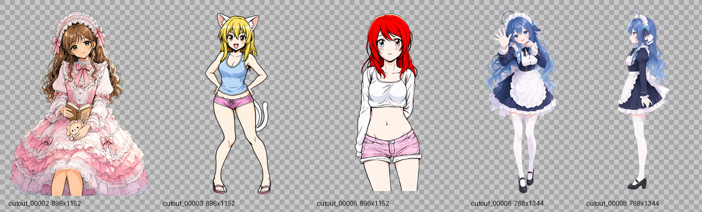
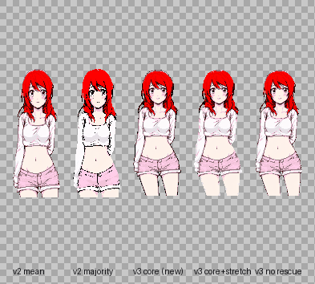
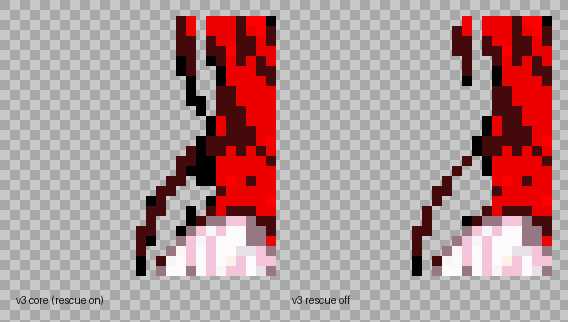
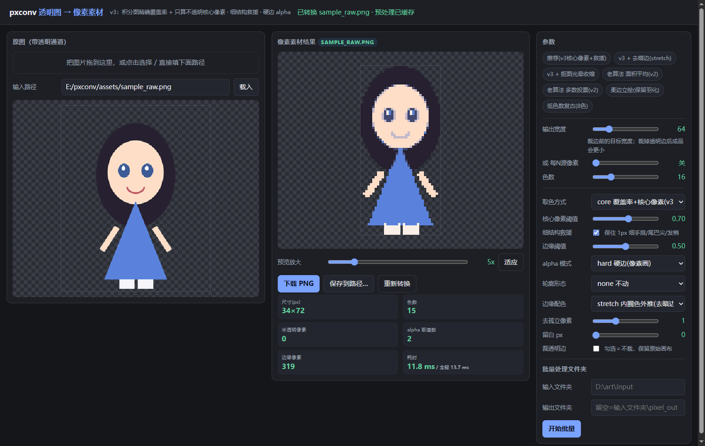

# pxconv

> **透明通道图片 → 像素素材（游戏 sprite）的「边缘优先」像素化工具。**
> 常规缩放会把抠图毛边糊成一圈半透明脏边、把 1px 的手指细腿吃掉、把颜色数炸到几千；
> pxconv 用**精确面积覆盖率 + 核心像素取色 + 细结构救援**解决这三件事，改参数是毫秒级。

**English** → [README.en.md](README.en.md) ｜ 中文



*仓库自带 5 张真实测试图（`assets/testset/`：抠图后的 AI 出图立绘，896×1152 与 768×1344 混合，背景都是 `alpha=1/255` 的「假透明」）。下面所有数字都出自这 5 张。*

---

## 一、主要成果（5 张真图实测，可复现）

统一设置：**输出宽度 128px / 24 色**，纯 CPU。

| 指标 | 普通 NEAREST / LANCZOS 缩放 | **pxconv v3** | 结论 |
|---|---|---|---|
| 半透明像素（像素画里的脏边） | **55,697 / 66,324**（5 图合计） | **0** | 5/5 张全部清零 |
| alpha 取值级数（均值） | 181 / 247 | **2**（只有 0 与 255） | 可逐像素编辑、可 palette swap |
| 输出可见色数（均值） | 5,559 / 6,055 | **24.0** | `--colors 24` 是硬上限，5 张都恰好 24 |
| 细结构保留率（手指/发丝/腰饰细线） | v2 系列 **12.2%** | **43.7%** | **3.6×**（关救援 12.9%） |
| 细结构碎片化（4-连通块，均值） | 7.2 | **2.6** | 断肢碎片从 7 块并到 3 块以内 |
| 改参数耗时（积分图命中缓存，均值） | v2 多数投票 **622 ms**<br>v2 面积平均 49.5 ms | **22.0 ms** | vs 多数投票 **28×**（逐图 23.9–34.9×） |
| 主体贴近图片底部时 | 896×1152→128px **丢掉 162 行（14.06%）** | 全图覆盖，0 行丢失 | 见「口径」与算法第 1 条 |

**逐图明细**（细结构列按各算法**自己覆盖的区域**归一化，理由见「口径」）：

| 测试图 | 源尺寸 | 源半透明px | NEAREST 半透明px / 色数 | **pxconv 半透明px / 色数** | 细结构 v2 → v3 | 缓存耗时 v2多数投票 → v3 |
|---|---|---|---|---|---|---|
| cutout_00002 | 896×1152 | 376,295 (36.5%) | 7,713 / 10,538 | **0 / 24** | 11.2% → **53.9%** | 626 → **21 ms** |
| cutout_00003 | 896×1152 | 475,269 (46.0%) | 9,840 / 2,541 | **0 / 24** | 17.0% → **22.3%** | 610 → **20 ms** |
| cutout_00005 | 896×1152 | 456,376 (44.2%) | 9,391 / 3,008 | **0 / 24** | 15.1% → **77.5%** | 600 → **17 ms** |
| cutout_00006 | 768×1344 | 496,509 (48.1%) | 13,947 / 7,301 | **0 / 24** | 8.2% → **31.3%** | 639 → **27 ms** |
| cutout_00008 | 768×1344 | 530,984 (51.4%) | 14,806 / 4,407 | **0 / 24** | 9.4% → **33.7%** | 636 → **25 ms** |



*cutout_00005（v3 增益最大的一张）五栏并排：v2 面积平均 ｜ v2 多数投票 ｜ **v3 core（默认）** ｜ v3 core + 去暗边 ｜ v3 关掉救援。棋盘格 = 透明区。*



*差异最密集的区域放大 10×（NEAREST）：左＝开救援，右＝关救援。注意左下斜向的细发丝与主体连接处、上方细条的下延段——右侧出现断点，左侧保持贯通。*

**复现命令**（克隆后即可跑，不需要任何私有素材）：

```bash
python tools/benchmark.py assets/testset/cutout_00005.png --size 128 --colors 24 --crop-control
python tools/edge_bench.py assets/testset/cutout_00005.png --sizes 64,128 --colors 16
pytest -q tests/                                     # 11 条不变量测试
```

**环境**：Windows 10 · Python 3.14.7（代码兼容 ≥3.10）· numpy 2.5.3 · Pillow 12.3.0 · Ryzen 5700X3D / 16 GB，**纯 CPU**（无 GPU、无 torch）。
CI（GitHub Actions，Linux，Python 3.10 / 3.12 / 3.13）同样全绿。

### 口径说明：为什么 v2 的细结构要用「自己覆盖的区域」算

v2 的整数分块会裁掉图片底部（见算法第 1 条），它实际渲染的区域比 v3 小。如果拿 v3 的网格去衡量 v2 的输出，
内容会整体错位，数字反而**虚高**：同一批图按 v3 网格算，v2 得到 **21.3%**；按它自己覆盖的区域算只有 **12.2%**。
上表用后者（公平口径，只比「渲染出来的那部分里细结构活下来多少」）；被完全丢掉的行另行单列。

---

## 二、算法优点

### 1. 精确面积覆盖率（分数边界 + 积分图），不是整数分块

大多数实现是 `arr[:bh*rows].reshape(rows, bh, ...)` —— **`bh = h // rows` 的整除会静默裁掉图片底部**。
实测 896×1152 → 128 宽：`rows=165, bh=6`，只覆盖 **990 行 = 丢掉 14.06% 的高度**，主体一靠下就整块消失；
而 768×1344 → 128 宽时 `1344/224 = 6` 正好整除，**一行都不丢** —— 这正是这类 bug 最阴的地方：
**换个宽高比才发作，输出尺寸看起来完全正常**。

pxconv 把每个输出格当作浮点边界矩形，用一张 5 通道积分图（SAT：alpha 和、核心像素计数、核心 RGB 和）做
**双线性边界求和**，每格 O(1)，格子严格铺满整图。`tests/test_pxconv.py::test_fractional_grid_covers_whole_image`
断言「所有格子覆盖的 alpha 总量」与源图误差 < 0.1%；`::test_v3_keeps_bottom_content_that_v2_crops` 是这个 bug 的反证测试（v2 保 0 格，v3 保 ≥20 格）。

### 2. 只用「不透明核心像素」取色 —— 边缘不会发暗

面积平均（alpha 加权）会把半透明边缘像素算进去，而抠图后的半透明像素**带着背景的隐藏 RGB（常见是黑）**，
一平均边缘就发暗发灰。pxconv 的取色只统计 `alpha >= --core-thr`（默认 0.7）的**核心像素**，
半透明 / 透明像素对颜色**零贡献**；调色板拟合同样只用核心像素，毛边色污染不到调色板。

这 5 张源图各有 **376,295 ~ 530,984 个半透明像素（占画面 36%~51%）**，把它们的颜色平均进来就是灾难；
pxconv 用 `--alpha-thr 0.5` 一把判为「不存在」，颜色只从核心像素来。

### 3. 细结构救援（hysteresis）—— 1px 手指、发丝、腰饰不会消失

纯阈值法（覆盖率 ≥ 0.5 才算像素）在小输出尺寸下必然切掉细线。pxconv 保留两类「弱格」：
**覆盖率 ≥ 0.4×阈值** 且 **8 邻域至少 2 个实心格** —— 连在身体上的细线活下来，孤立噪点不保留；
没有核心像素的轮廓格再用**最近核心色逐层扩散**填充，避免细线变成黑洞。

实测（5 图平均）：**12.2% → 43.7%（3.6×）**，其中 cutout_00005 是 15.1% → **77.5%**；
连通块 7.2 → 2.6（不再断成一堆碎片）。关掉救援立刻回落到 12.9% —— **增益确实来自救援这一步，而不是别的调参运气**。

### 4. 调色板「收口」—— `--colors` 是硬上限

边缘修色若直接写「邻居平均色」，平均色不在调色板里 → 色数从 24 爆到几百（对照组普通缩放在这 5 张上是
2,541 ~ 10,538 色）。pxconv 的边缘配色改为**调色板索引操作**（内圈众数色 / 内圈原色外推），
最后统一 `snap_to_palette()` 收口，所以可见像素永远 ≤ `--colors`：**5 张图实测全部恰好 24 色**，
`test_palette_cap_is_enforced` 在 8/16/24 三档都做了断言。

### 5. alpha 二值化 + 硬边轮廓，拿到的是「真像素画」

输出 alpha 只有 0 / 255（5 图实测 **alpha 级数 = 2、半透明像素 = 0**）。需要柔边（发光立绘、UI）时用
`--alpha-mode keep` 保留覆盖率渐变 —— 那时它就不是像素画，这个取舍是显式的，不是意外。

### 6. 一次预处理 + 按图缓存 → 参数可以随便拖

`prepare()` 每张图只建一次积分图（896×1152 含读图约 100 ms），调色板按 `(colors, core_thr, method)` 缓存，
查询每格 O(1)。所以「改参数」从 v2 多数投票的 **622 ms** 降到 **22 ms**（28×，逐图 23.9–34.9×），
比 v2 面积平均也快 2.3×。调色板用 PIL 中位切分（C 实现）而不是自写 k-means（1.5 s → 20 ms）。

---

## 三、快速开始

```bash
git clone https://github.com/Satyr-Astry/pxconv.git
cd pxconv
python -m venv .venv && . .venv/bin/activate     # Windows: .venv\Scripts\activate
pip install -r requirements.txt                  # numpy + pillow，仅此两个
```

**单张转换（推荐默认参数）**

```bash
python pxconv.py assets/testset/cutout_00005.png -o out.png --size 128 --colors 24
```

**批量**

```bash
python pxconv.py assets/testset/ -o out/ --size 96 --colors 16
```

输出两张：`out.png`（原生尺寸真像素 sprite）与 `out_preview.png`（NEAREST 放大 + 棋盘格；≥8× 时叠网格线）。
`--size` 是**裁边前**的目标宽度，最终尺寸会更小（例如 128 → 64×160），这是正常行为。

**当作库调用**

```python
import argparse, pxconv as P

src = P.load_rgba("assets/testset/cutout_00005.png")   # HxWx4 float32, 0~1
cols, rows = P.target_grid(src.shape[0], src.shape[1], 128, None)
o = argparse.Namespace(size=128, pixel_size=None, colors=24, alpha_thr=0.5,
                       cov_thr=0.5, core_thr=0.7, rescue="on", palette_method="median",
                       alpha_mode="hard", edge="none", edge_color="keep",
                       sample="core", despike=1, pad=0, no_trim=False,
                       preview_scale=4, no_preview=True)
sprite = P.convert(src, cols, rows, o, prep=P.prepare(src, 0.7))   # prep 可复用/缓存
P.save_rgba(sprite, "sprite.png")
```

`pip install .` 之后也可以直接用命令行入口 `pxconv`。

---

## 四、参数

| 参数 | 取值 | 默认 | 作用 |
|---|---|---|---|
| `input` / `-o` | 路径 | — | 输入（文件或目录）/ 输出 |
| `--size` | 整数 | — | 目标输出**宽度**（裁边前） |
| `--pixel-size` | 整数 | — | 换一种说法：每 N 个源像素并 1 像素 |
| `--colors` | 整数 | `16` | 调色板上限（`0` = 不限） |
| `--sample` | `core` / `mean` / `majority` / `center` | `core` | `core` = v3（推荐）；其余是 v2 老算法，留作对比 |
| `--core-thr` | 0~1 | `0.7` | 多大 alpha 才算「核心像素」（参与取色） |
| `--alpha-thr` / `--cov-thr` | 0~1 | `0.5` | 覆盖率阈值；调高 = 轮廓瘦一圈 |
| `--alpha-mode` | `hard` / `keep` | `hard` | `hard` = alpha 只有 0/255（像素画）；`keep` = 保留柔边 |
| `--rescue` | `on` / `off` | `on` | 细结构救援 |
| `--edge` | `none` / `shrink` / `grow` | `none` | 轮廓腐蚀 / 膨胀 1px（去抠图光晕） |
| `--edge-color` | `keep` / `avg` / `stretch` | `keep` | 边缘配色修复（`stretch` 去暗边最有效，但会轻微改变轮廓色） |
| `--palette-method` | `median` / `kmeans` | `median` | 调色板拟合方式（`kmeans` 更匀但慢） |
| `--despike` | 整数 | `1` | 清掉 8 邻域 ≤1 邻居的孤立像素（0 = 关） |
| `--no-trim` / `--pad N` | 开关 / 整数 | 裁边 / `0` | 自动裁透明边 / 裁完留 N px 空白 |
| `--preview-scale` / `--no-preview` | 整数 / 开关 | `6` / 关 | 预览放大倍数 / 不生成预览 |

**尺寸经验（来自这批 896×1152 / 768×1344 立绘）**：**128px 起步（平衡），160px 要细节**；96px 以下会明显丢手脚细节。
二次元平涂 16~24 色够；写实图 24 色偏「脏」，上 48 色以上。

---

## 五、本地网页 UI（改参数立刻看效果）

```bash
python ui/server.py 8765        # 然后打开 http://127.0.0.1:8765
```

Windows 用户可直接双击 `scripts/start-ui.bat`（纯标准库实现，**不需要 Flask**）。
三栏布局：左＝原图（棋盘格）｜中＝像素结果 + 8 项实时指标｜右＝参数 + 批量。
带 7 个预设芯片、防抖自动重算、放大预览、`下载 PNG` / `保存到路径`、批量跑文件夹并打包 zip。



*UI 里改任一参数都会重算整张图：上例 34×72 成品耗时约 12 ms（同一张图连续调参数）。*

HTTP API（可脚本调用）：`POST /api/convert`、`POST /api/save`、`POST /api/batch`、`GET /api/presets`。

---

## 六、目录

```
pxconv.py              核心：算法 + CLI（单文件，只依赖 numpy/Pillow）
ui/server.py           本地网页 UI 后端（http.server，零框架）
ui/index.html          UI 前端（三栏 / 预设 / 实时指标 / 批量）
tools/benchmark.py     速度 · 细结构保留率 · 底部裁剪对照（可复现实验）
tools/edge_bench.py    边缘参数矩阵实测（出指标表 + 每组预览图）
tools/contact_sheet.py 多尺寸并排对比图（挑 48/64/96/128/160 哪档合适）
tools/compare_sheet.py 多算法并排对比图
tools/make_sample.py   生成合成测试图（带软 alpha 边缘）
tests/test_pxconv.py   11 条不变量测试（pytest 或直接 python 跑）
assets/testset/        5 张真实测试图（抠图后的 AI 立绘，RGBA）
assets/                对比图 / 放大图 / UI 截图 / 合成示例图
docs/ALGORITHM.md      算法推导、管线顺序、指标定义、参数敏感性
scripts/start-ui.bat   Windows 一键起 UI（CRLF + 纯 ASCII）
```

---

## 七、局限与负面结果（诚实清单）

- **增益取决于图里有没有「细结构」**：5 张里 cutout_00003 只从 17.0% 提到 **22.3%**（主体饱满、细线少），而 cutout_00005 提到 **77.5%**。救援不是万能滤镜——对本来就没有细线的图，收益有限。
- **关掉救援的 v3 ≈ v2 的质量**（12.9% vs 12.2%）：v3 的轮廓质量优势本来就来自救援这个机制本身，而不是另换了一套阈值魔术。这一点必须说清楚。
- **「边缘色差」指标对线稿图是假信号**：它把角色自带的黑描边当成「边缘不干净」，把线稿糊掉的旧算法反而得分更低。请用**细结构保留率 + 连通块数 + 肉眼**三件套；该指标已从 UI 移除，只在 `tools/edge_bench.py` 留作参考。
- **`--edge shrink` 别用在极小输出尺寸**：会削断 1px 结构，`边缘色差` 会跳到 50+（不是渗色，是细结构被削掉后参考失真）。
- **`--alpha-mode keep` 产出的不是像素画**：保留上百种 alpha 值（合成示例 64px 下 1,359 个半透明像素），只适合柔边立绘 / UI 发光。
- **不做放大**：只做下采样；预览放大是 NEAREST，不补细节。
- **不做亮色轮廓增强**（PixelOE 那类效果）；描边功能曾实现但已停用（代码在 `pxconv.py` 底部「归档」段）。
- **不共享动画帧调色板**：多帧 sprite 请自己固定调色板，否则播放时颜色会闪。
- **积分图内存** O(5·W·H·4B)：896×1152 约 21 MB，4K 图会到几百 MB —— 超大图请先切分。
- **调色板 `kmeans` 模式慢**：全量 k-means 在百万像素上是秒级；默认 `median`（PIL 中位切分）才是实时路径。
- **真·柔内容**（半透明阴影、烟雾、发光）硬边化必然损失，属于方法不适用，不是 bug。

---

## 八、许可

MIT — 见 [LICENSE](LICENSE)。第三方项目参考说明在 [NOTICE.md](NOTICE.md)（本仓库不含任何第三方代码）。
`assets/testset/` 的 5 张立绘是作者本机 AI 出图后抠图所得，仅作为测试语料随仓库提供。
